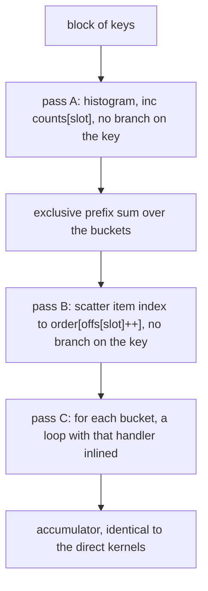
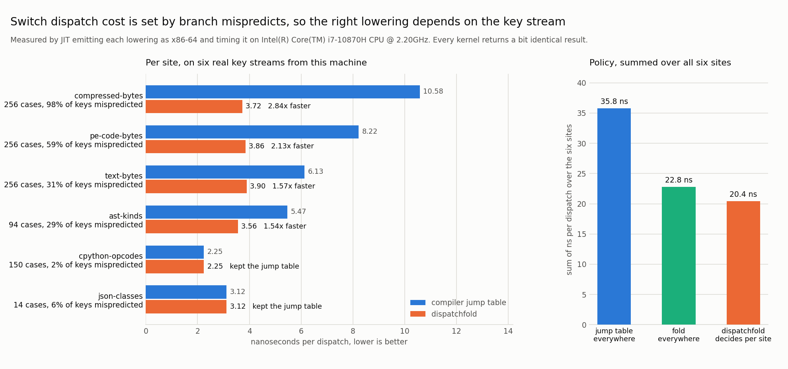

# dispatchfold

Decides, per switch site, whether to keep the jump table a compiler emits or to
fold the dispatch into branchless bucketing plus one specialised loop per
handler, by measuring what a mispredict actually costs on your CPU and how
predictable your real key stream is.

## The problem

Every compiler lowers a `switch` from static properties of the cases: how many
there are, how densely they pack, and sometimes a static branch probability.
LLVM and GCC both pick a jump table once the cases are dense enough, because a
jump table is one indirect branch instead of a chain of compares.

That reasoning ignores the only thing that turns out to matter. On this machine
a *correctly predicted* indirect jump costs about the same as no dispatch at
all, roughly 1 ns, while a mispredicted one costs 8.7 ns, about 19 cycles.
Dispatch cost is therefore almost entirely a function of how predictable the
key stream is, and the key stream is not something a compiler looks at. The
same jump table over the same 256 cases measures 2.25 ns per dispatch on a
CPython opcode trace and 10.58 ns on the bytes of a compressed file. That is a
4.7x spread with identical generated code.

So there is a decision nobody is making. When the stream is unpredictable, the
right move is not a better branch, it is no branch: bucket the items by key
without branching, then run each handler over its own contiguous run. When the
stream is predictable, that bucketing is pure overhead and the jump table
already wins. Nothing in the toolchain decides which case you are in.

## What it does

`dispatchfold` is a benchmark and decision tool that:

1. **Emits x86-64 at runtime.** A small assembler (`dispatchfold/x64.py`) builds
   complete dispatch loops, which are loaded into RWX pages and called through
   `ctypes`. There is no C compiler in the loop, and no simulation: the numbers
   come from running the code.
2. **Implements four lowerings** of the same dispatch site: an if-else chain, a
   balanced binary search tree, a dense jump table (optionally with hot cases
   peeled out in front), and the folded kernel.
3. **Calibrates your CPU** by timing nine synthetic streams chosen to spread
   out over predictability, then fitting two linear cost models by least
   squares. On this machine the fit is `direct = 2.34 ns + 8.68 ns per
   mispredict` and `folded = 3.16 ns + 2.98 ns per repeat + 9.04 ns per bucket
   per block`, with a 0.43 ns residual.
4. **Estimates the mispredict rate of your stream** by simulating a TAGE style
   indirect predictor over it, because what decides the cost is not the key
   histogram but the sequence. A stream of long runs over 256 equally frequent
   cases is predicted nearly perfectly; an i.i.d. stream over the same 256
   cases misses on almost every key.
5. **Picks the cheaper kernel** and reports what it picked, what it predicted,
   and what actually happened.

Every lowering returns a bit identical accumulator, checked on every run and in
the test suite, including for keys outside the case domain and streams that are
not a multiple of the block size.

## Why this is worth doing

The folded kernel is doing strictly more work: two extra passes over the block
and a scattered store per item. It wins anyway, by up to 2.84x on real data,
because it trades about 2 ns of guaranteed work for 8.7 ns of coin flip. That
is the whole trade and it is invisible to a compiler that looks only at case
density.

Three results worth pointing at:

- **Interpreter dispatch is not the mispredict disaster it is usually described
  as.** The real CPython opcode stream mispredicts on 1.7% of dispatches on a
  modern predictor, and the plain jump table is the fastest option for it by a
  wide margin. Folding it would cost 54%.
- **Byte oriented decoders are the opposite.** Dispatching on the bytes of a
  compressed stream misses 98% of the time, and folding is 2.84x faster.
- **The naive advice is wrong in both directions.** Always folding loses 38% on
  the JSON scanner; never folding loses 65% on the compressed stream. Choosing
  per site beats both: 1.75x over always using a jump table, and with zero
  regret, the model picked the faster kernel on 6 of 6 sites.

The folded shape itself is the batching idea from vectorised query execution
and from GPU divergence handling, but applied at the level of a single switch
and, crucially, made conditional on a measured property of the machine and the
data rather than adopted wholesale.

## Architecture

FigJam board: https://www.figma.com/board/pt3ZXPvlGgt6Av8FKDVgoU

The diagram shows how a real key stream and a dispatch site flow through
calibration and the stream statistics into the cost model, which chooses
between the jump table kernel and the folded kernel before both are emitted as
x86-64, loaded, and timed against the same reference accumulator.

The folded kernel, per block of items:



The key never steers a branch in passes A and B: the range check is a `cmov`,
not a jump. In pass C the only data dependent branch is each bucket's loop
back, which is taken `run_length - 1` times in a row, so the predictor is wrong
at most once per bucket per block instead of once per item.

## Results



The metric is nanoseconds per dispatch, measured by timing a JIT emitted loop
that walks a real key stream and runs one handler per key. The baseline is the
dense jump table, which is what a production compiler emits for every one of
these six sites. "After" is whichever kernel `dispatchfold` chose, which is the
folded kernel on four sites and the unchanged jump table on the other two.

All six key streams are harvested from the machine the benchmark runs on, in
the order a real program would see them, because order is what the branch
predictor feeds on:

| workload | what it stands for | cases | mispredicted | jump table | dispatchfold | result |
|---|---|---|---|---|---|---|
| compressed-bytes | byte dispatch in an entropy or container decoder | 256 | 98% | 10.58 ns | 3.72 ns | 2.84x faster |
| pe-code-bytes | opcode byte dispatch in an instruction decoder | 256 | 59% | 8.22 ns | 3.86 ns | 2.13x faster |
| text-bytes | byte dispatch in a UTF-8 scanner or lexer | 256 | 31% | 6.13 ns | 3.90 ns | 1.57x faster |
| ast-kinds | node kind dispatch in a visitor | 94 | 29% | 5.47 ns | 3.56 ns | 1.54x faster |
| json-classes | character class dispatch in a JSON scanner | 14 | 6% | 3.12 ns | 3.12 ns | kept the table |
| cpython-opcodes | bytecode dispatch in an interpreter eval loop | 150 | 2% | 2.25 ns | 2.25 ns | kept the table |

Summed over the six sites: 35.76 ns with a jump table everywhere, 22.81 ns
folding everywhere, and 20.41 ns letting `dispatchfold` decide per site, so
**1.75x over the compiler baseline and 1.12x over blanket folding**. The
decision was right on all six sites, so the total regret against an oracle that
always picks the faster kernel is 0.000 ns.

The cost model is predictive, not just descriptive. Across the six sites its
mean absolute error is 0.55 ns for the jump table kernel and 0.18 ns for the
folded kernel, against values ranging from 2.25 ns to 10.58 ns, and it was fit
only on synthetic calibration streams that none of the six workloads
resembles.

The win does not come from handlers that do nothing. Adding dependent
arithmetic to every handler on the compressed-bytes site moves the speedup from
3.08x with an empty handler to 2.18x with sixteen extra operations per handler,
because the added work is paid equally by both kernels while the mispredict
saving stays:

| extra ops per handler | jump table | folded | speedup |
|---|---|---|---|
| 0 | 11.50 ns | 3.73 ns | 3.08x |
| 2 | 11.16 ns | 4.16 ns | 2.69x |
| 4 | 11.07 ns | 4.04 ns | 2.74x |
| 8 | 12.15 ns | 4.62 ns | 2.63x |
| 16 | 13.18 ns | 6.06 ns | 2.18x |

## How to run it

Requires Windows on x86-64 and Python 3.9 or newer. The JIT allocates RWX pages
with `VirtualAlloc` and emits x86-64 directly, so neither the platform nor the
architecture is optional.

```
pip install -r requirements.txt

python -m dispatchfold all        # calibrate, benchmark, write docs/results.json and the chart
python -m dispatchfold calibrate  # just measure this CPU's dispatch constants
python -m dispatchfold bench      # calibrate and benchmark, no chart
python -m dispatchfold chart      # re-render docs/before_after.png from results.json

python demo.py                    # smallest end to end example, about 30 seconds
python -m unittest discover -s tests -v
```

Useful flags: `--body-ops N` adds N dependent operations to every handler, and
`--block N` changes how many items the folded kernel buckets at a time (default
4096, sized so the index array stays in L1).

The whole thing is five source files and no dependencies beyond matplotlib and
numpy, which are used for the chart and the least squares fit respectively, not
by the kernels.

## Example output

A real run of `python demo.py` on an Intel Core i7-10870H:

```
host: Intel(R) Core(TM) i7-10870H CPU @ 2.20GHz

calibrating on this CPU (65536 keys per point)
  stream        miss repeat  table ns  fold ns
  uniform256   0.996  0.004     11.34     3.92
  uniform64    0.984  0.016     11.00     3.18
  uniform16    0.937  0.062     10.32     3.36
  uniform4     0.751  0.248      8.67     3.96
  zipf64       0.867  0.118      9.43     3.72
  hot90        0.126  0.810      3.54     6.15
  hot99        0.012  0.981      1.49     6.45
  cycle7       0.000  0.000      2.66     3.11
  runs64       0.220  0.877      5.05     5.04
direct: 2.34 ns + 8.68 ns per mispredict
folded: 3.16 ns + 2.98 ns per repeat + 9.04 ns per bucket per block
fit residual: 0.427 ns

compressed-bytes: byte dispatch in an entropy or container decoder
  source           first 1048576 bytes of pip-25.0.1-py3-none-any.whl
  keys             131072 over 256 cases
  mispredict rate  0.982   repeat rate 0.008
  predicted        jump table 10.86 ns, folded 3.75 ns, so pick fold
  measured         jump table 10.58 ns, folded 3.72 ns
  faster in fact   fold  (model was right)
  every lowering returned the same accumulator: True

json-classes: character class dispatch in a JSON scanner
  source           466192 bytes of levenshtein_examples.json
  keys             131072 over 14 cases
  mispredict rate  0.059   repeat rate 0.420
  predicted        jump table 2.85 ns, folded 4.45 ns, so pick table
  measured         jump table 3.12 ns, folded 4.31 ns
  faster in fact   table  (model was right)
  every lowering returned the same accumulator: True
```

The calibration rows are the argument in miniature. `uniform256` and `cycle7`
both dispatch over many cases, but one misses on 99.6% of keys and the other on
none, and the same jump table costs 11.34 ns on the first and 2.66 ns on the
second. Meanwhile `hot99` is the folded kernel's worst case at 6.45 ns: nearly
every key lands in the same bucket, so the histogram increment in passes A and
B serialises on store forwarding, which is exactly the case where the jump
table is already at its best, 1.49 ns.

`docs/results.json` holds every timing, the fitted cost model, the calibration
table, the per site decisions, and the handler sweep from the run that produced
the chart.

## When folding is a legal rewrite

The folded kernel runs handlers in a different order than the source program
would, so it is only valid where per item handlers commute: each item's handler
may read the item and append to output, but must not depend on what the
previous item's handler decided. That is the normal situation for scanners,
classifiers, record parsers, and column at a time processing, and it is what
makes vectorised query execution work.

It does not hold for a live interpreter loop, where the next key is produced by
the current handler, so there is no batch of keys to bucket in the first place.
The `cpython-opcodes` workload is included because it is a real, heavily
studied dispatch stream and it anchors the predictable end of the range; the
model declines to fold it regardless.

Two more honest limits: the handler bodies here are a short fixed instruction
sequence, so these numbers isolate dispatch cost rather than model a specific
application (the `--body-ops` sweep above shows what happens as handlers get
heavier), and every number comes from one machine. Run
`python -m dispatchfold all` to get your own.

## Layout

```
dispatchfold/x64.py        x86-64 encoder: ModRM and SIB, labels, jump tables
dispatchfold/jit.py        RWX allocation, loading, and the timing harness
dispatchfold/lowering.py   the four lowerings, including the folded kernel
dispatchfold/profiles.py   the six real key streams harvested from the host
dispatchfold/model.py      TAGE predictor simulation, calibration, cost model
dispatchfold/bench.py      the benchmark that writes docs/results.json
dispatchfold/chart.py      renders docs/before_after.png
tests/                     encoding tests and cross lowering equivalence tests
demo.py                    smallest end to end example
```

## License

MIT
